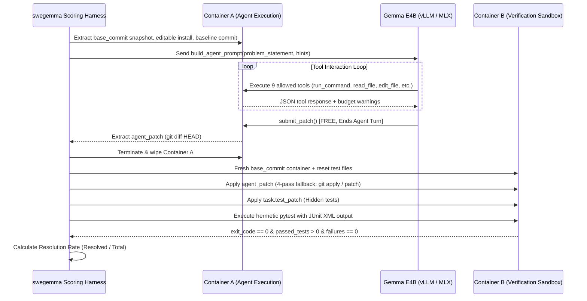
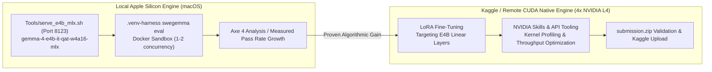

# AGENTS.md: Gemma 4 Developer Agent Competition

Solo entry in Kaggle's "Google - The Gemma 4 Developer Agent Competition" ([Kaggle Competition Link](https://www.kaggle.com/competitions/gemma-4-developer-agent)) plus the Paper Track.
Goal: Top 3 on the main leaderboard AND win the **$10,000 Small Model Bonus Prize**. Resume from [CHECKPOINT.md](CHECKPOINT.md).

---

## 1. Deadlines & Milestones (11:59 PM UTC)
- **Paper Track**: Nov 12, 2026 (*Passed*).
- **Entry & Team Merger Deadline**: **Nov 25, 2026** (Accept competition rules & finalize team before this date).
- **Final Submission Deadline**: **Dec 2, 2026** (Both the Main Track and the **$10,000 Small Model Bonus** close on Dec 2, 2026 at 23:59 UTC, confirmed by host Elan Markowitz in forum thread 751104).
- **Small Model Prize Requirement**: Highest ranking submission using Gemma E2B or E4B as base model; **must be chosen as one of the team's 2 selected final submissions**.

---

## 2. Mandatory Submission Worktree Replica (The Submission Zip Blueprint)

Every submission package (`submission.zip` generated in Kaggle working dir) **must strictly conform** to the official declarative structure:

```text
submission.zip
├── agent.yaml              # REQUIRED: Root agent config (or root_agent.yaml)
├── eval_config.yaml        # CRITICAL: Per-task operational budgets (prevents 12h run failure)
├── configs/
│   └── sampling.yaml       # Generation parameters loaded via !include
├── prompts/
│   ├── system.md           # Root system instructions loaded via !include
│   └── analyzer.md         # Sub-agent prompt definitions
├── sub_agents/
│   └── code_analyzer.yaml  # Sub-agent or AgentTool YAML configurations
├── adapters/               # PEFT LoRA adapters (< 3 GiB total budget)
│   ├── main_lora/
│   │   ├── adapter_config.json
│   │   └── adapter_model.safetensors
│   └── tool_lora/
│       ├── adapter_config.json
│       └── adapter_model.safetensors
└── skills/                 # ADK Skill packages
    └── repo_navigation/
        ├── SKILL.md        # YAML frontmatter + Markdown tool usage manual
        ├── scripts/        # Python scripts executed in the container (.py ONLY!)
        └── resources/      # Domain knowledge markdown files
```

### Critical File Format & Pathing Constraints:
- **Allowed Extensions ONLY**: `.yaml`, `.yml`, `.md`, `.txt`, `.py`, `.json`, `.safetensors`.
- **FORBIDDEN / REJECTED EXTENSIONS**: `.sh` (validator rejects bash scripts in skills!), `.bin`, `.pt`, `.pth`, `.pyc`, `.DS_Store`, `.bak`, `.gitkeep`, or extensionless files. Any non-conforming file causes immediate validation rejection.
- **Sandboxed `!include` Directive** (verified 2026-11-17 against `adk_submission/yaml_loader.py::_resolve_include_path` and a live load):
  - Paths resolve relative to the file containing the tag, then must land **inside the submission root**.
  - `..` is allowed when the resolved target stays inside the root: `sub_agents/x.yaml` may use `!include ../prompts/x.md` (the official sample does this).
  - Rejected with `PathTraversalError`: a target that escapes the root (`../../outside.md`), absolute paths, null bytes, and any symlink in the target or its parents. The target must exist and be `.md`, `.txt`, `.yaml` or `.yml`.
- **Archive Size**: Total unpacked submission size must be strictly `< 3 GiB` (`3,221,225,472` bytes), adapters included.

---

## 3. What CAN Be Optimized vs. What CANNOT Be Messed With

### What Specifically CANNOT Be Messed With (Disqualification / Zero-Score Hazards):
1. **Base Model Invariance**:
   - `len(models) == 1` across all agents (`agent.yaml`, all `sub_agents/*.yaml`, and inline agents).
   - Must be declared as `gemma-4-e4b-it-qat-w4a16-ct`. (Mixing models or using undeclared models raises `ParticipantVisibleError`).
2. **No Python Submission Entrypoints**:
   - Competitors do NOT submit executable Python files (`agent.py` or `agent_fn`) at the root. Everything is compiled by `adk-submission` from declarative YAML.
3. **Sequential Execution & 12-Hour Hard Timeout**:
   - All ~120 evaluation tasks run sequentially in a single 12-hour job.
   - **Exceeding 12 hours causes the entire submission to error and receive a score of 0.0.**
   - Omitted `eval_config.yaml` defaults to "no limit" in the scorer, guaranteeing job failure. You **must** set per-task ceilings:
     ```yaml
     evaluation:              # canonical, from AgenticSubmission/v7_brigade_lite/eval_config.yaml
       timeout_seconds: 300   # per shell command (competition default; capped at time left)
       max_tool_calls: 40     # observed v6 max 15
       max_time_minutes: 5    # 720 - ~10 vLLM start - ~30 setup = 680 min / 120 tasks = 5.67
       max_turns: 60
     ```
     The harness enforces `max_time_minutes` with `asyncio.timeout` around the whole agent run, so an in-flight model call cannot overrun it.
4. **Air-Gapped Offline Sandbox (`network_mode="none"`)**:
   - No internet access at runtime. Zero external API calls, curl commands, or pip installs.
5. **Protected Test Files & Anti-Tampering Engine**:
   - Changes to test files (`test_*.py`, `*_test.py`, `tests/`) and test runner files (`conftest.py`, `pytest.ini`, `pyproject.toml`, `tox.ini`, `setup.cfg`, `sitecustomize.py`) are forcefully stripped before Phase 2 verification. Agents must fix library code only!
6. **Workspace Pollution**:
   - `submit_patch()` captures `git add -N . && git diff HEAD`. Untracked files in `/workspace` enter the patch.
   - Scratch files and reproduction scripts MUST be stored in `/tmp/`, NEVER in `/workspace/`.
7. **Sandbox Resource Quotas**:
   - 4 GiB RAM (exceeding triggers exit code 137 SIGKILL), 2 vCPUs.
8. **Forbidden Keys in `generate_content_config`**:
   - Setting `tools`, `system_instruction`, `http_options`, `safety_settings`, or `response_schema` inside `generate_content_config` raises validation errors.

### What CAN and SHOULD Be Optimized (The Performance Levers):
1. **Prompts & Reasoning Architecture**:
   - Root instructions in `prompts/system.md` (test-driven reproduction, strict code inspection before editing).
   - `generate_content_config`: `temperature: 0.2`, `top_p: 0.95`, `max_output_tokens: 16384`, `thinking_config: {thinking_budget: 4096, include_thoughts: true}` (competition defaults). **Owner rule (2026-11-17), do not ask to change:** output and thinking budgets stay at the competition defaults, `max_output_tokens: 16384` and `thinking_budget: 4096` for every role that thinks (a role may keep thinking off). Per-task time comes from the 12 h limit: `max_time_minutes: 5`. Command timeout: competition default `300` s, which the harness caps at the time left. vLLM 0.33 clamps `max_tokens` to the remaining context (a 20,014-token prompt with 16,384 requested returned 200), so 16,384 is safe. `thinking_budget` is enforced by the scorer's vLLM, not by local MLX; `include_thoughts: true` keeps thoughts in later turns' context. Omit `thinking_level` with vLLM LoRA endpoints.
2. **Sub-Agent Decomposition (`sub_agents/`)**:
   - Wrap deep exploratory code searches in an `agent_tool` with `skip_summarization: true` to protect the root agent's 32,768-token context window.
3. **ADK Skills (`skills/`)**:
   - Code navigation and retrieval routines implemented in Python (`skills/<name>/scripts/*.py`).
   - SemDAG graph traversal or BM25 code indexing executed via `run_skill_script`.
4. **PEFT LoRA Adapters (`adapters/`)**:
   - Fine-tuned PEFT LoRA adapters targeting `gemma-4-e4b-it-qat-w4a16-ct` (rank $r \le 128$, `.safetensors`).
   - Sizing: $r=16$ (~110–220 MB), $r=32$ (~220–450 MB). Multiple adapters can be served simultaneously (`main_lora`, `tool_lora`).
5. **Phase 1 Tooling Protocol**:
   - Mastering the 9 allowed tools (see Section 4).

---

## 4. The SWE-Python Benchmark & Two-Phase Lifecycle

The `swegemma` evaluation engine scores submissions using a strict two-container lifecycle:



### The 9 Authorized Harness Tools:
1. `run_command(command)`: Shell execution in `/bin/bash -c` under `/workspace`. 5,000 char output cap. Timeout `min(300s, remaining_time)`. Counts toward `tool_calls`.
2. `submit_patch()`: Captures `git diff HEAD`. **FREE** (0 tool calls), but **terminates the agent session**. Always call last!
3. `get_status()`: Queries remaining tool calls, time, and patch state. **FREE** (0 tool calls).
4. `read_file(filepath, start_line, end_line)`: Line slicing. Capped at **150 lines** and **10,000 chars**. Counts.
5. `edit_file(filepath, old_string, new_string, allow_multiple=False)`: 3-tier resilient matching (`exact` $\to$ `flexible` whitespace $\to$ `regex`). Counts.
6. `write_file(filepath, content)`: Creates/overwrites files and creates parent directories. Counts.
7. `get_code_neighbors(node, edge_type, max_neighbors=50)`: Code graph call-graph navigation. Capped at 5,000 chars. Counts.
8. `search_similar_code(query, k=10)`: Vector similarity search over pre-computed `.npz` node embeddings. **Pass symbol names (`Class.method`)**, not raw free text! Capped at 5,000 chars. Counts.
9. `get_code_subgraph(nodes)`: Subgraph neighborhood extraction. Capped at 5,000 chars. Counts.

---

## 5. Dual-Engine Workflow: Local MLX vs. Remote CUDA Native



### Local Development Loop (Apple Silicon):
1. **Local Model Server**: `Tools/serve_e4b_mlx.sh` serves the 4-bit MLX model at `http://127.0.0.1:8123/v1` (`~/models/gemma-4-e4b-it-qat-w4a16-mlx`).
2. **Validation, local scored-style runs and tests**:
   ```bash
   # Validate a submission directory
   .venv-harness/bin/python -c "from pathlib import Path; from adk_submission import validate_directory; from swegemma.config import build_submission_limits; validate_directory(Path('AgenticSubmission/v6_1_budget'), limits=build_submission_limits()[0])"
   # Scored-style local run: no network (macOS seatbelt), Docker Desktop (never Colima),
   # MLX server on 8124 behind the telemetry proxy on 8125, budget read from the
   # submission's eval_config.yaml. Post-run: SQLite ingest, TELEMETRY.md, baked Docker image.
   Tools/run_eval_seatbelt.sh AgenticSubmission/v6_1_budget results/<run_dir> <ids_file> <run_id> <arm>
   # Tests
   .venv-harness/bin/python -m pytest
   ```
   Port 8123 is sometimes held by a ClickHouse container on this machine; local runs use 8124 (model) and 8125 (proxy). Telemetry docs: `Tools/telemetry/README.md`.
   *Note*: Local Docker memory is 8 GB; each container takes 4 GiB, so maintain concurrency at 1 or 2.

### Remote CUDA Native Execution (Kaggle L4x4 GPUs):
- **Hardware**: Dedicated machine with 4x NVIDIA L4 GPUs (96 GB total VRAM).
- **Inference Runtime**: vLLM on `127.0.0.1:8000` with `tensor_parallel_size=4`, `max_model_len=32768`, `tool_call_parser='gemma4'`, `reasoning_parser='gemma4'`.
- **NVIDIA Tooling & Optimization**: Utilize the repository's NVIDIA skills (`nvidia-skill-finder`, `tao-setup-nvidia-gpu-host`, TensorRT-LLM profiling) to maximize token throughput and minimize adapter switching overhead, ensuring sequential runs stay safely under the 5-minute per-task limit.
- **PEFT Training**: Train LoRAs on Kaggle L4x4 instances. Only transfer weights to `adapters/` once local algorithmic enhancements prove distinct metric gains.

---

## 6. Layout Reference
- `DataSets/public/data/`: Extracted tasks (`tasks.jsonl`), snapshots, graphs, embeddings, wheels, docker, sample submission.
- `DataSets/public/wheelhouse/`: Official wheels (`swegemma`, `adk_submission`, `adk_eval_core`).
- `AgenticSubmission/`: Candidate submission architectures (`v0_baseline` stock reference, `v2_bm25`, `v4_semdag`, `v6_impact` frozen, `v6_1_budget` current).
- `Models/`: Symlink to CUDA checkpoint. MLX copy: `~/models/gemma-4-e4b-it-qat-w4a16-mlx`.
- `Tools/convert_ct_to_mlx.py`: Lossless repack of compressed-tensors checkpoint to MLX 4-bit.
- `Tools/serve_e4b_mlx.sh`: Local OpenAI-compatible server on `127.0.0.1:8123` (`_8124.sh` variant when 8123 is taken).
- `Tools/run_eval_seatbelt.sh`, `Tools/seatbelt/no_network.sb`, `Tools/telemetry/`: no-network local runs with SQLite telemetry (see `Tools/telemetry/README.md`).
- `tests/` + `pytest.ini`: host-side test suite (`.venv-harness/bin/python -m pytest`).
- `PaperTrack/`: Research paper artifacts and results.
- `.venv-harness`: Evaluation harness environment (Python 3.13, swegemma).
- `.venv-mlx`: Local MLX serving environment. Do not mix with `.venv-harness`.

---

## 7. Operational Commandments & Gotchas

1. **Keep `edit_file` payloads small**: Huge thought blocks followed by giant edits can exceed `max_output_tokens` and clip `<|tool_call|>`. Keep edits incremental.
2. **Scratch files go in `/tmp`**: Never leave temporary files in `/workspace`; `submit_patch` will capture them into the patch and cause grading failures.
3. **Never edit `/workspace/pytest.ini` or `conftest.py`**: The harness commits these at baseline; edits will enter `git diff HEAD` and corrupt verification.
4. **Always verify before calling `submit_patch()`**: `submit_patch()` is free but immediately ends the agent turn.
5. **No private code sharing**: Violates Kaggle competition rules.
6. **No unverified numbers**: Every claim in documentation or writeups must be backed by a verified `swegemma eval` run artifact.

---

## 8. Host-Side Verified Research Memory

- During design and paper research, query the canonical local Qdrant Edge shard at `/Users/stewartbarteau/Desktop/Ai Research and Preprint Vault/qdrant-edge-research-v1` before repeating literature searches.
- After opening and verifying primary sources, ingest full extracted text or exact relied-upon passages through `/Users/stewartbarteau/Desktop/Fraud-Predict Comp/src/rag_ingest.py`, including URL, title, year, and an evidence note.
- Ingest verified public research only. Never ingest competition snapshots, task data, model outputs, private code, credentials, unpublished scores, or hidden-test evidence.
- Preserve existing dense vectors and the scored text index. Use payload-only deterministic points, the shard lock, hash verification, live retrieval checks, and a receipt under this project's research documentation.
- This is a host-side research facility only. The scored Gemma runtime has no internet and may call only the nine allowed harness tools; never package the Edge shard or expose `rag_ingest` as an additional submission-runtime tool.
