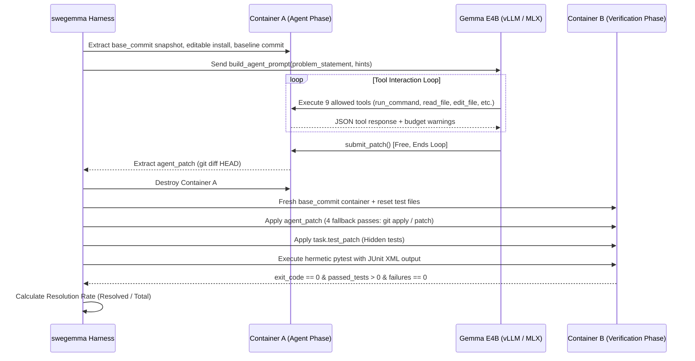
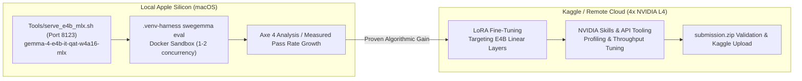

# CLAUDE.md — Operating Instructions for Gemma 4 Developer Agent (E4B Project)

This document contains the authoritative, non-negotiable operational guidelines, competition boundaries, architecture specifications, and local-to-cloud workflows for operating the Gemma 4 Developer Agent repository (`gemma-4-e4b-it-qat-w4a16-ct`).

---

<!-- session-start:begin -->
## 0. Session Start (owner rule, 2026-11-18)

**Read [README.md](README.md) first, every session**, then [CHECKPOINT.md](CHECKPOINT.md) and [MEMORY.md](MEMORY.md). This folder is the source of truth: it is a git repo with no remote, and GitHub is behind it.

Current state in one paragraph: v6_impact (7/23 on paired23, local MLX) is the best measured and is frozen as the reference. v7 tied it. v8_ensemble scored 0/5 and times out at the 4-minute budget locally. No Kaggle submission has been made. Nov 25 is entry and rules acceptance; Dec 2 is the final deadline. Budget is fixed by the owner at 4 min/task with the competition-default token budgets. Never tune or train on the public tasks. Update README.md and MEMORY.md at the end of every session.
<!-- session-start:end -->

## 1. Executive Summary & Objective

- **Competition**: Kaggle "Google - The Gemma 4 Developer Agent Competition" ([Kaggle Competition Link](https://www.kaggle.com/competitions/gemma-4-developer-agent)).
- **Primary Goal**: Win Top 3 on the global leaderboard AND capture the **$10,000 Small Model Bonus Prize**.
- **Model Mandate**: Sole base model is **`gemma-4-e4b-it-qat-w4a16-ct`**.
- **Critical Deadlines (23:59 UTC)**:
  - **Nov 25, 2026**: Team merger deadline & competition entry rules acceptance.
  - **Dec 2, 2026**: Final submission deadline. (Small Model Bonus deadline is confirmed Dec 2; E4B must be selected as one of your two final submissions).
- **Core Strategy**: Dual-engine development loop:
  1. **Local Apple Silicon (MLX)**: Rapid zero-cost algorithmic iteration (SemDAG graph traversal, prompt engineering, ADK skills, sub-agent schemas) tested locally against Docker SWE-bench snapshots.
  2. **Remote Cloud / Kaggle (CUDA Native on 4x L4)**: PEFT LoRA fine-tuning, NVIDIA-optimized vLLM inference profiling, and hermetic submission packaging.

---

## 2. Mandatory Submission Worktree Replica (The Visual Blueprint)

Your submission zip (`submission.zip` or packaged candidate) **MUST strictly mirror** this exact declarative directory structure:

```text
submission.zip
├── agent.yaml              # REQUIRED: Root agent config (or root_agent.yaml)
├── eval_config.yaml        # CRITICAL: Per-task operational budgets (prevents 12h run exhaustion)
├── configs/
│   └── sampling.yaml       # Generation parameters loaded via !include
├── prompts/
│   ├── system.md           # Root system instructions loaded via !include
│   └── analyzer.md         # Sub-agent prompt definitions
├── sub_agents/
│   └── code_analyzer.yaml  # Sub-agent or AgentTool YAML configurations
├── adapters/               # PEFT LoRA adapters (< 3 GiB total budget)
│   ├── main_lora/
│   │   ├── adapter_config.json
│   │   └── adapter_model.safetensors
│   └── tool_lora/
│       ├── adapter_config.json
│       └── adapter_model.safetensors
└── skills/                 # ADK Skill packages
    └── repo_navigation/
        ├── SKILL.md        # YAML frontmatter + Markdown tool usage manual
        ├── scripts/        # Python scripts executed in the container (.py ONLY!)
        └── resources/      # Domain knowledge markdown files
```

### Critical File Extension & Traversal Rules:
- **Allowed Extensions ONLY**: `.yaml`, `.yml`, `.md`, `.txt`, `.py`, `.json`, `.safetensors`.
- **STRICTLY FORBIDDEN / DISQUALIFYING FILES**: `.sh` (validator rejects bash scripts!), `.bin`, `.pt`, `.pth`, `.pyc`, `.DS_Store`, `.bak`, `.gitkeep`, or extensionless files (e.g. `LICENSE`). A single stray file will fail `adk_submission` validation!
- **Sandboxed `!include` Directive** (verified 2026-11-17 against `adk_submission/yaml_loader.py::_resolve_include_path` and a live load):
  - Paths resolve relative to the file containing the tag, then must land **inside the submission root**.
  - `..` is allowed when the resolved target stays inside the root: `sub_agents/x.yaml` may use `!include ../prompts/x.md` (the official sample does this).
  - Rejected with `PathTraversalError`: a target that escapes the root (`../../outside.md`), absolute paths, null bytes, and any symlink in the target or its parents. The target must exist and be `.md`, `.txt`, `.yaml` or `.yml`.

---

## 3. Strict Competition Constraints & Disqualification Hazards

### What Specifically CANNOT Be Messed With (Disqualification & Zero-Score Risks):
1. **Single Base Model Rule**:
   - `len(models) == 1` across the entire submission tree (`agent.yaml`, all `sub_agents/*.yaml`, and inline agents).
   - Base model must be declared exactly as: `gemma-4-e4b-it-qat-w4a16-ct`. (The bf16 alias `gemma-4-e4b-it` is for local CLI only and will fail remote validation).
2. **No Python Code Entrypoints**:
   - Submissions do not include `agent.py` or `agent_fn`. Agents must be compiled declaratively by `adk-submission` via YAML.
3. **12-Hour Hard Global Wall-Clock Ceiling**:
   - All ~120 evaluation tasks run **sequentially in a single 12-hour job**.
   - If the cumulative runtime exceeds 12 hours, **the entire submission errors and scores 0.0**.
   - **MANDATORY**: You must include `eval_config.yaml` with explicit bounds:
     ```yaml
     evaluation:              # canonical, from AgenticSubmission/v7_brigade_lite/eval_config.yaml
       timeout_seconds: 300   # per shell command (competition default; capped at time left)
       max_tool_calls: 40     # observed v6 max 15
       max_time_minutes: 4    # owner rule 2026-11-17 (12 h ceiling is 5.67 after ~10 vLLM start + ~30 setup)
       max_turns: 60
     ```
     The harness enforces `max_time_minutes` with `asyncio.timeout` around the whole agent run, so an in-flight model call cannot overrun it.
4. **Offline Sandboxing (`network_mode="none"`)**:
   - Containers have no internet. No pip installs, no curl, no external API calls during evaluation.
5. **Protected Files & Anti-Tampering Mechanism**:
   - The harness automatically strips modifications to test files (`test_*.py`, `*_test.py`, `tests/`) and runner configs (`conftest.py`, `pytest.ini`, `pyproject.toml`, `tox.ini`, `setup.cfg`).
   - Any agent attempting to "fix" tests by modifying assertions or runner configs will have its patch stripped, causing Phase 2 verification to fail.
6. **Scratch File Leakage**:
   - `submit_patch()` runs `git add -N . && git diff HEAD`. Any untracked file left in `/workspace` will be included in the diff.
   - **MANDATORY**: All temporary scripts, repro files, or logs must be written to `/tmp/`, NEVER `/workspace/`.
7. **Resource Caps**:
   - Container limits: 4 GiB RAM (exceeding causes exit code `137`), 2 vCPUs.
   - Total uncompressed submission size: `< 3 GiB` (3,221,225,472 bytes) including all LoRAs.

---

## 4. The SWE-Python Benchmark & Two-Phase Verification Lifecycle

Every evaluation task runs through two distinct sandboxes:



### The 9 Authorized Harness Tools:
1. `run_command(command)`: Bash execution in `/workspace`. Truncated to 5,000 chars. Counts toward budget.
2. `submit_patch()`: Generates diff and marks task complete. **FREE** (counts 0 tool calls), but **terminates the session turn**. Always run last!
3. `get_status()`: Queries remaining tool calls and time. **FREE** (counts 0 tool calls).
4. `read_file(filepath, start_line, end_line)`: Line-sliced reading. Capped at **150 lines** and **10,000 chars**. Counts.
5. `edit_file(filepath, old_string, new_string, allow_multiple=False)`: 3-tier resilient matcher (`exact` $\to$ `flexible` whitespace $\to$ `regex`). Counts.
6. `write_file(filepath, content)`: Creates or overwrites files. Counts.
7. `get_code_neighbors(node, edge_type, max_neighbors=50)`: Code graph call-graph navigation. Capped at 5,000 chars. Counts.
8. `search_similar_code(query, k=10)`: Pre-computed `.npz` vector similarity. **Pass symbol names (e.g. `Class.method`)**, not raw natural language text! Capped at 5,000 chars. Counts.
9. `get_code_subgraph(nodes)`: Subgraph neighborhood extraction. Capped at 5,000 chars. Counts.

---

## 5. What CAN and MUST Be Optimized

### A. Prompts & Cognitive Protocols (`prompts/system.md`)
- Enforce strict test-driven bug reproduction:
  1. Isolate the failure using `search_similar_code` or `get_code_neighbors`.
  2. Write an isolated reproduction script in `/tmp/repro.py`.
  3. Inspect implementation files using `read_file`.
  4. Perform atomic surgical fixes via `edit_file`.
  5. Validate the fix with `/tmp/repro.py` via `run_command`.
  6. Call `submit_patch()` once clean.

### B. Sub-Agent Architectures (`sub_agents/`)
- Wrap deep exploration in an `AgentTool` with `skip_summarization: true`. This prevents multi-step search traces from polluting the root coder's 32,768-token context window.

### C. ADK Skills (`skills/`)
- Implement domain-specific navigation scripts in Python (`skills/<skill_name>/scripts/*.py`).
- Implement SemDAG or BM25 retrieval scripts that run via `run_skill_script`.

### D. Multi-LoRA Adapters (`adapters/`)
- PEFT LoRA rank $r \le 128$, `.safetensors` format.
- Multi-adapter routing: Bind `adapter: main_lora` to the primary coder and `adapter: search_lora` to the exploration agent.

### E. Sampling Hyperparameters (`configs/sampling.yaml`)
- `temperature: 0.2`, `top_p: 0.95`, `max_output_tokens: 16384`, `thinking_config: {thinking_budget: 4096, include_thoughts: true}` (competition defaults). **Owner rule (2026-11-17), do not ask to change:** output and thinking budgets stay at the competition defaults, `max_output_tokens: 16384` and `thinking_budget: 4096` for every role that thinks (a role may keep thinking off). Per-task time: `max_time_minutes: 4` (owner rule; the 12 h ceiling allows up to 5). Command timeout: competition default `300` s, which the harness caps at the time left. The scorer runs a patched vLLM 0.19.1 (staff, 2026-09-28 and 2026-10-15); its `get_max_tokens` clamps `max_tokens` to the remaining context and only rejects a prompt that alone exceeds 32,768. Live on vLLM 0.33 (vllm-metal): a 20,014-token prompt with 16,384 requested returned 200. So 16,384 is safe. `thinking_budget` is enforced by the scorer's vLLM, not by local MLX; `include_thoughts: true` keeps thoughts in later turns' context. Omit `thinking_level` with vLLM LoRA endpoints.

---

## 6. Dual-Engine Workflow: Local MLX vs. CUDA Native



### Local Execution Commands (Apple Silicon):
```bash
# Validate a submission directory
.venv-harness/bin/python -c "from pathlib import Path; from adk_submission import validate_directory; from swegemma.config import build_submission_limits; validate_directory(Path('AgenticSubmission/v6_1_budget'), limits=build_submission_limits()[0])"
# Scored-style local run: no network (macOS seatbelt), Docker Desktop (never Colima),
# vllm-metal server (SERVER=vllm_metal) on 8124 behind the telemetry proxy on 8125, budget read from the
# submission's eval_config.yaml. Post-run: SQLite ingest, TELEMETRY.md, baked Docker image.
SERVER=vllm_metal Tools/run_eval_seatbelt.sh AgenticSubmission/v6_1_budget results/<run_dir> <ids_file> <run_id> <arm>
# Tests
.venv-harness/bin/python -m pytest
```
**Local model server: vllm-metal** (vLLM 0.33 on MLX, owner decision 2026-11-18), launched by `Tools/local/serve_vllm_metal_kaggle.sh` with the scorer's vLLM flags on the competition weights, port 8124, behind the telemetry proxy on 8125. Run the runner with `SERVER=vllm_metal` (its default is still `omlx`). Known gap: vllm-metal rejects `thinking_token_budget` (HTTP 400), so the thinking budget is not enforced locally; use a literal `<|think|>` in the role prompt. Gates and throughput: `results/server_bench/vllm_metal/NOTES.md`. The scorer is patched vLLM 0.19.1 on 4x L4, so local timing still does not predict it.

Port 8123 is sometimes held by a ClickHouse container on this machine; local runs use 8124 (model) and 8125 (proxy). Telemetry docs: `Tools/telemetry/README.md`.

### CUDA Native Pipeline (Remote L4x4 GPUs):
- **Serving**: vLLM with `tensor_parallel_size=4`, `tool_call_parser=gemma4`, `reasoning_parser=gemma4`, `max_model_len=32768`.
- **NVIDIA Optimization**: Use the installed NVIDIA skills (`tao-setup-nvidia-gpu-host`, `nvidia-skill-finder`, TensorRT-LLM profiling) to maximize token generation throughput and ensure adapter switching overhead fits within the 5-minute per-task window.
- **Kaggle Notebook Rule**: All Kaggle training/submission notebooks must run hermetically with internet disabled at evaluation time.

---

## 7. Submission Preparation Checklist

Before packaging any directory into `submission.zip`:
- [ ] Exactly one root config file (`agent.yaml`).
- [ ] Every declared model is strictly `gemma-4-e4b-it-qat-w4a16-ct`.
- [ ] `eval_config.yaml` is present with `max_time_minutes <= 5`.
- [ ] Only authorized extensions (`.yaml`, `.yml`, `.md`, `.txt`, `.py`, `.json`, `.safetensors`).
- [ ] NO bash `.sh` scripts, `.DS_Store`, `.pyc`, or `.bak` files present.
- [ ] No symlinks or `..` traversals in YAML files.
- [ ] Total uncompressed directory size is `< 3 GiB`.
- [ ] Any LoRA adapter directory in `adapters/` contains only `adapter_config.json` and `adapter_model.safetensors` (rank $\le 128$).
- [ ] Validated with `validate_directory` using `.venv-harness`.
