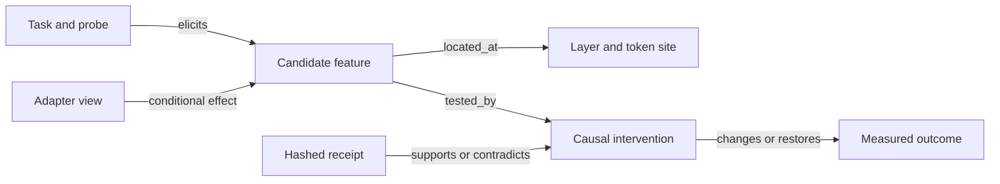

# Executive Summary

This design makes the proposed E4B activation study inspectable as a time-indexed relational graph. Each link from a coding task to a feature, intervention, adapter view, or outcome carries a reproducible evidence receipt. Obsidian provides a navigable view while the experiment ledger remains authoritative.

# Problem Statement

A static map can make recurrent activation look like a discovered circuit even when it is a lexical artifact or a one-run coincidence. It also hides when a feature appeared, under which control, and whether intervention changed the answer. The study needs to preserve these relationships and their sequence before assigning a basin or pruning a component.

# Solution Overview

Treat “4D” as a **time-indexed relational graph**: three coordinates describe a candidate activation embedding only when fitted and validated; the fourth coordinate is experiment time/sequence. The H3×T2 and twelve-well construction remains an optional tested embedding, not a literal four-dimensional brain map. Project ledger events into linked Obsidian notes and frozen time slices. Layout position and node proximity in Obsidian have no evidentiary force.

# Implementation Details

## Graph vocabulary

| Node | Identity and purpose |
|---|---|
| `task` | Repository, public task ID, split, prompt digest; no held-out gold content. |
| `operation` | Preregistered probe such as symbol binding, data flow, API retrieval, or counterexample search. |
| `site` | Exact checkpoint, module/layer, token-position class, and capture point. |
| `feature` | Frozen-base direction, sparse feature, or activation cluster with fitted-transform digest. |
| `basin` | Candidate recurrent trajectory group; status starts `proposed`. |
| `view` | Scoped information condition or compiled adapter alias and digest. |
| `intervention` | Patch, ablation, restoration, random, norm-matched, or lexical-decoy control. |
| `outcome` | Patch validity, targeted behavior, collateral behavior, and measured uncertainty. |
| `receipt` | Immutable source artifact hash and command/config provenance. |

Allowed directed edge types: `declares` (run manifest or end receipt), `elicits` (task→feature), `located_at` (feature→site), `candidate_for` (feature→operation or basin), `recurs_in` (feature→task), `tested_by` (feature/basin→intervention), `changes` (intervention→outcome), `restores` (intervention→outcome), `retains` (intervention→preserved coding behavior), `routes_to` (view→feature), `supports` and `contradicts` (receipt→claim). `routes_to` means a measured conditional effect, never mere gate membership, and cannot be `observed` from gate membership. `critical` and `unnecessary` are claim classes on this same evidence chain, not extra edge types: `critical` needs a repeated concordant `changes` pair of metric `behavior_change` plus one `restores` event of metric `behavior_restored`; `unnecessary` needs a repeated concordant null `changes` pair of metric `behavior_change` plus one `retains` event of metric `coding_accuracy_delta`. Logit KL and activation norm cannot discharge either label. Low activation norm is neither claim. Every edge has `status: proposed|observed|inferred|refuted`, `evidence_ids`, metric, comparator, confidence interval, and the analysis version that assigned its status. No edge is promoted to `observed` from a visual pattern alone. Selectivity stays `proposed` until the causal pair exists.

## Event ledger and time

One append-only JSONL event per observation or intervention result, with canonical JSON serialization and SHA-256 content digest. Required fields: `schema_version`, `event_id`, `run_id`, `sequence`, `time_utc`, `node_ids`, `edge_type`, `status`, `model_sha256`, `tokenizer_sha256`, `data_split_digest`, `task_id`, `prompt_sha256`, `condition_id`, `seed`, `capture_site`, `token_span_class`, `metric_name`, `metric_value`, `comparator_id`, `artifact_sha256`, and `parent_event_ids`. Store large activations separately by content hash; the ledger carries summaries and references. The first event in a run records the preregistered manifest hash. An end receipt binds the ordered event hashes, code revision, hardware/runtime, and completion state. A partial run stays partial.

`time_utc` is for human chronology. `sequence` is monotonic within a run and is the replay order. Cross-run comparisons use explicit run IDs and matched conditions, not wall-clock proximity. Store baseline, decoy, ablation, restoration, and adapter events independently, including null and failed outcomes. Never overwrite a prior event to make a graph cleaner; append a correction linked to it.

## Obsidian projection

Generate an offline vault under a research-output directory outside `AgenticSubmission/`. Create one note per stable node and one note per intervention receipt, with YAML properties (`id`, `kind`, `status`, `run_id`, `timestamp`, `digest`, `split`) and wikilinks to related nodes. A run index links all controls, and a time-slice index links the graph at chosen sequence cutoffs. Regenerate the vault atomically from the validated ledger; direct note edits are commentary only. Obsidian graph and search make relationships browsable; a true time scrubber or 3D rendering would require a separate viewer and is not claimed here. The vault must not sync private repository code, prompts, credentials, or held-out material.

## Observation and decision loop

1. Freeze a probe family and split before capture. Capture frozen-base trajectories for matched task pairs, lexical decoys, and unrelated controls.
2. Fit candidate features and any embedding on training data only. Assign provisional operations by a blinded, reproducible classifier; inspect false positives.
3. Replay held-out probes to measure recurrence across repositories and lexical forms. Record all failures and confidence intervals.
4. Intervene at exact sites with matched random and norm controls; restore the candidate component. Record targeted and collateral effects.
5. Test whether a compiled LoRA view changes the same sites and outcomes more than equal-rank controls. Keep association and causation labels separate.
6. Admit a basin only if recurrence, selectivity, causal effect, and restoration criteria pass their preregistered thresholds. Otherwise retain it as proposed or mark it refuted. Pruning requires a separate retention gate.

The graph is a watch instrument, not the judge. It can point reviewers to a suspicious causal claim, a missing control, or a changed trajectory. Held-out task resolution and independent behavioral checks decide whether the adapter helps.

## Files Modified

| File | Lines | Change type | Description |
|---|---:|---|---|
| `obsidian-4d-observer.md` | 1-151 | new | Observer contract and causal evidence rules |
| `design.md` | 1-754 | modified | Integrates observer into the experiment |
| `README.md` | 1-117 | modified | Indexes observer and status |

## Languages Chosen and Why

| Language | Component | Rationale |
|---|---|---|
| Markdown | Human contract and Obsidian notes | Diffable, linkable, permitted research artifact. |
| JSONL | Planned immutable event ledger | Streamable records with deterministic validation and hashing. |

Next step: define a versioned JSON Schema and a deterministic exporter only after capture-site and metric names are finalized by the E4B feasibility probe. A rushed schema would freeze guessed tensor semantics.

## Grounding in Verifiable Literature

The local [design](design.md) registers the carved-swarm records, Whitehead contract, and primary activation/SAE references. These motivate scoped controls and falsification; none establishes an E4B subnetwork or a native Obsidian 4D graph.

## Configuration Changes

None. This document adds no runtime hook, package file, or model endpoint change.

# Testing Evidence

## Test Files and Locations

`observer/test_observer.py`. Ledger and vault: `observer/out/e4b-mlx-capture-20261111T074425Z/`.

## What the Tests Showed

The validator rejected criticality and pruning labels built from logit KL, activation norm, a single pass, a missing twin, or a failed retention value. The MLX capture ledger validated, exported a vault, and admitted zero `critical` and zero `unnecessary` claims. Layout is not evidence. No basin is claimed.

## Test Command to Reproduce

From `Designs/SharedLoRABank/observer`, with the repo `.venv-mlx` interpreter: `python -m unittest test_observer.py`. The capture command is `python capture_probe.py`.

## Was It Proven Necessary?

The need to distinguish recurrence from causal selectivity follows from the study's H2 claim. The specific Obsidian projection is a review workflow choice and has not been empirically compared with another viewer.

# Deployment / Rollout

| Aspect | Detail |
|---|---|
| Deployment date | Not deployed |
| Rollout | Feasibility probe → schema → recorder → validation → Obsidian projection |
| Rollback | Remove generated projection; retain immutable event ledger and receipt hashes |
| Monitoring | Missing controls, broken hash chain, unlinked claims, drift across time slices |
| Post-deploy validation | Replay records, verify hashes, compare graph to raw outcomes |

# Next Stage of Implementation

Capture sites, the event schema, the validator, and the Obsidian exporter now exist for the MLX research copy. The next measurement that can move a label is a repeated `behavior_change` pair plus `behavior_restored` or `coding_accuracy_delta`. Logit KL stays a measurement. The rank-4 adapter probe has not been run.

# What We Learned

Time and causal controls must be first-class graph data. A navigable graph can aid review, but its visual topology cannot establish internal model topology.

# Changelog

| Version | Date | Author | Change |
|---|---|---|---|
| 0.1.0 | 2026-11-11 | Codex | Defined the temporal relational observer, evidence receipts, Obsidian projection, and causal admission loop. |
